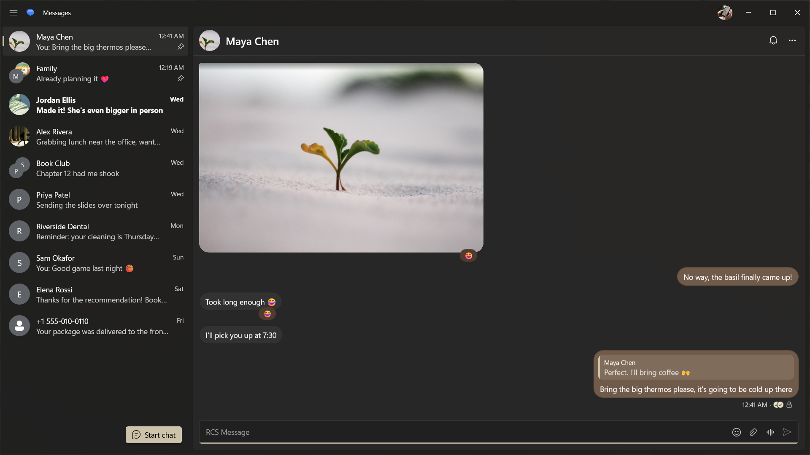

<p align="center">
    
</p>

<h1 align="center">
    Kaituro
</h1>

<p align="center">
    Google Messages for Windows: text, share photos and reply to notifications from your PC, right from the tray.
</p>



## What It Adds

Kaituro does everything Google Messages for Web does, as a real Windows app. On top of that, you get:

- **Lives in the tray.** Close the window and Kaituro keeps running, so new messages still come in. Turn on Start with Windows and it's there when you sign in.
- **Windows notifications you can answer.** Reply right from the notification, snooze it, or mute the chat, without opening anything.
- **A mute bell in the chat header.** Mute or unmute a chat in one click.
- **Pick your microphone.** Choose which mic records your voice messages in Settings.
- **Undo archive.** Ctrl + Z puts back the last chat you archived.
- **More shortcuts.** Ctrl + S shows or hides the sidebar, and Ctrl + , opens Settings. Press Ctrl + ? to see them all.
- **Fits in on Windows 11.** Follows your light or dark theme, and the window opens where and how big you left it.

## Building

### Prerequisites

- Windows 11
- [Visual Studio 2026](https://visualstudio.microsoft.com/) with the **.NET desktop development** and **Desktop development with C++** workloads (the C++ tools build the Native AOT release)
- [.NET 10 SDK](https://dotnet.microsoft.com/download)
- [Node.js](https://nodejs.org/), only if you change the icon

### Run It

Build the app, then run its exe:

```powershell
dotnet build src/GMessages.App -c Debug -p:Platform=x64
.\src\GMessages.App\bin\x64\Debug\net10.0-windows10.0.26100.0\win-x64\Kaituro.exe
```

> A debug build keeps its data in `%LOCALAPPDATA%\Kaituro`, apart from the installed app, so you'll pair it separately.

### Build The Installer

Releases are signed MSIX packages for x64 and ARM64. The first time, create the signing certificate and trust it on your PC from an elevated PowerShell:

```powershell
.\scripts\New-DevCertificate.ps1
```

Then build the packages:

```powershell
.\scripts\Build-Package.ps1
```

They land in `src\GMessages.App\AppPackages`. Open the `.msix` for your PC to install it.

> The certificate's subject has to match `Publisher` in `src/GMessages.App/Package.appxmanifest`. If you're building your own copy, change both to your own and pass it with `-Subject` and `-CertificateSubject`.

### Run The Tests

```powershell
dotnet test src/GMessages.Presentation.Tests
dotnet test src/GMessages.App.UITests -p:Platform=x64
```

> The UI tests drive a real copy of the app against a fake Google server. Quit the installed Kaituro first, and rebuild `src/GMessages.App` before running them so they don't test an old build.

### Change The Icon Or Screenshots

- `.\scripts\Make-Icons.ps1` redraws every icon size and the tray icons from `assets-src/Kaituro.svg`.
- The store screenshots in `docs/screenshots` come from a mock phone. Retake them with:

```powershell
$env:KAITURO_SCREENSHOTS = 1; dotnet test src/GMessages.App.UITests -p:Platform=x64 --filter StoreScreenshots
```
